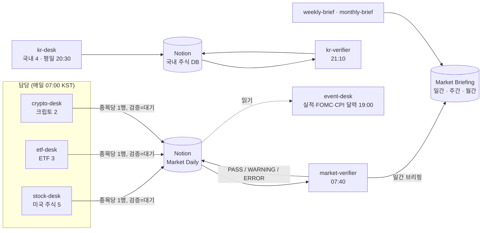

> **market-watch** is a multi-agent pipeline where Claude agents research 10 watchlist assets every morning, write one Notion row each, and a separate verifier agent recomputes every number and grades the row.
> Scheduled cloud routines run the desks, verification, daily/weekly/monthly briefings and an event calendar without a human in the loop; rules live in versioned prompt files.
> This repo shows the prompts, scripts, evaluation and incident log behind it. Not investment advice.

**사례 연구 페이지:** https://ejmogly.github.io/market-watch/ (수치·평가 결과·사고와 가드레일을 한 장에)

# market-watch — AI 직원들이 매일 관심 종목을 조사하고 서로 검증하는 파이프라인

관심 종목 10개(미국 주식 5 · ETF 3 · 크립토 2)와 국내 주식 4개를 AI 에이전트가 매일 조사해 Notion에 한 행씩 쓰고, 별도의 검증 에이전트가 모든 수치를 다시 계산해 판정을 남깁니다.

## 문제

개인 투자자가 관심 종목 10개를 매일 확인하려면 종목마다 가격, 이동평균, 뉴스, 목표가를 여러 사이트에서 모아야 합니다. 시간이 들고, 손으로 옮기다 보면 실수가 생깁니다.
- 종목마다 판단 기준이 조금씩 달라진다(어제는 50일선, 오늘은 느낌).
- 출처와 조회 시각이 남지 않아 나중에 무엇을 보고 판단했는지 확인할 수 없다.
- 오래된 기사나 잘못 옮긴 숫자를 걸러 줄 사람이 없다.

market-watch는 이 일을 담당 에이전트와 검증 에이전트로 나누고, 모든 종목에 **같은 식**을 적용하게 한 뒤, 검증 결과까지 기록으로 남깁니다.

## 구조



- **예약 루틴 10개**가 클라우드에서 돈다: 해외 담당 3, 검증 1(일간 브리핑 포함), 국내 담당·검증 2, 주간·월간 브리핑 2, 이벤트 데스크 1, 뉴스 페이지 갱신 1. 이 저장소에는 뉴스 페이지 갱신을 뺀 9개의 프롬프트가 있다.
- 프롬프트는 **역할 파일 + 공통 규칙**을 `routines/build.py`로 조립한다(`routines/_*.md` → `*.prompt.md`). 규칙을 한 곳에서 고치면 모든 루틴에 같이 반영된다.
- 사람이 직접 돌릴 때는 Claude Code 서브에이전트(`.claude/agents/`)로 같은 역할을 부른다.
- 판단 규칙은 모든 종목이 같은 식을 쓴다: 가격·50일선·200일선으로 관심 / 관망 / 비중 축소, 이동평균·ATR로 분할 매수·손절·차익 실현 구간. 전체 규칙은 [`docs/rules.md`](docs/rules.md).

## 결과

| 지표 | 값 | 기준 |
|---|---|---|
| 검증 에이전트의 오류 검출률 | 66.7% → **91.7%** (같은 세트), 33.3% → **66.7%** (규칙 수정 뒤 새로 만든 holdout), 오탐 0 유지 | 놓친 유형만 겨냥해 검증 항목 4개 추가 후 재측정. 결함 12+6 · 정상 8+2행, claude-sonnet-5 96회 4.99 USD (`eval/REPORT.md`) |
| 예약 실행 | 291회, 시작 지연 중앙값 3.2분. 직전 스냅숏 뒤 cron 기준 누락 0 / 282. 로그를 읽은 37회는 모두 세션 정상 종료 | 2026-09-25 ~ 2026-11-06 전체 실행 308회 중 예약 실행. 정상 종료는 작업 완료와 다르다: 37회 중 2회는 시세 수집 실패로 멈췄고 5회는 쓸 것이 없어 끝났다 (`metrics/ops_metrics.md`) |
| 가드레일 적용 전 → 후 위반 | 알림 8/14 → 0/33 실행, 회사 이메일 3/13 → 0/32, 보조 에이전트 3/18 → 0/29 | 로그를 읽은 47회만 센다. 2026-09-27 스냅숏 뒤 282회 중 28회만 읽었고 무작위 표본이 아니다 (`metrics/runs.jsonl`) |
| 검증이 먼저 잡은 이슈 | 발견자 확인 33건 중 18건(55%), 재발 13건 중 12건은 재계산·대조로 드러남 | 이슈 47건 분류, 2026-09-24 ~ 27 기준 (`metrics/issues_summary.md`) |
| 비용 | 측정 못 함 | 실행 로그에 토큰과 비용이 나오지 않는다. 실행 1회 중앙값 11.2분(예약 실행 전체), 40턴(로그 읽은 실행) |
| 판단 규칙 대 단순 보유 | 수익률 3/13 자산에서 우위, 최대 낙폭은 11/13 자산에서 얕음 | 2025-01 ~ 2026-11 일봉, 겹치지 않는 60거래일 창과 부트스트랩 (`metrics/signal_eval.md`) |

수치는 모두 `scripts/`와 `eval/`의 스크립트로 다시 계산할 수 있다. 운영 수치는 2026-11-06 스냅숏 기준이다. 표본이 작은 항목은 n을 함께 적는다.

## 사고 3건과 가드레일

예약 실행은 사람이 지켜보지 않으므로, 한 번 생긴 문제는 규칙이 아니라 **도구 권한과 검사**로 막았다. 전체 기록은 [`docs/rules.md`](docs/rules.md)의 이슈 기록 표에 있다.

| 무슨 일이 있었나 | 가드레일 |
|---|---|
| 이벤트 데스크가 외부 API(SEC)에 보낼 연락처 이메일을 **지어서** 썼다 | 외부 요청 연락처는 정해진 주소 하나만 쓰도록 공통 규칙에 명시하고, 공개본을 만들 때 이메일 패턴을 검사한다(`scripts/export_public.py`) |
| 시험 실행이 **시키지 않은 휴대폰 알림**을 보냈다 | 루틴 설정에서 알림 도구를 막았다. 규칙 문장보다 도구 차단이 확실하다 |
| 국내 실적 일정 조사를 **보조 에이전트에 맡기고** 결과를 받기 전에 실행이 끝나 조사 결과가 사라졌다 | 10개 루틴 모두 보조 에이전트·예약 깨우기 도구를 막고, "조사는 직접, 결과를 반영한 뒤에만 마지막 보고"를 프롬프트에 넣었다 |

## 발견: 판단 규칙은 수익 신호가 아니라 위험 관리 도구였다

2024-01부터 받은 일봉으로 2025-01 이후 매일의 판단을 같은 규칙으로 다시 계산해 보니, 추세 규칙이 미국 대형주·크립토에서 거꾸로 작동한 구간이 있었다. 예를 들어 NVDA는 "관심" 판단 뒤 60거래일 평균 +2.5%, "비중 축소" 판단 뒤 +50.4%였다.

규칙을 더 복잡하게 만들어 과거에 맞추는 대신, 규칙은 그대로 두고 행마다 **과거 참고** 한 줄(그 자산·그 판단의 과거 60거래일 평균 수익률과 오른 비율)을 붙였다. 읽는 사람이 판단의 과거 성적을 함께 보게 하려는 것이다. 표는 `scripts/label_context.py`가 만들고 `build.py`가 프롬프트 끝에 붙인다.

그 뒤 표본을 다시 뽑았다(`scripts/signal_eval.py`). 매일의 판단 뒤 60일을 세면 이웃한 날끼리 기간이 겹쳐 같은 상승장을 여러 번 센다. 창을 겹치지 않게 뽑자 판단 사이의 차이는 신뢰구간 안에서 거의 사라졌다(13자산 합산 60거래일: 관심 +0.8%p, 비중 축소 −1.8%p, 90% 구간이 서로 겹침). "거꾸로 작동한다"는 인상은 겹치는 표본의 착시에 가까웠다. 규칙을 비중(관심 100%·관망 50%·비중 축소 0%)으로 쓰면 13개 중 11개 자산에서 최대 낙폭이 얕아지고, 수익률은 10개 자산에서 단순 보유보다 낮았다. 이 기간(2025-01 ~ 2026-11)에서 규칙은 수익을 더하는 신호가 아니라 낙폭을 줄이는 도구였다. 표본 밖 성과는 2026-09-26부터 `scripts/forward_track.py`로 따로 쌓는다. 이 사후 점검은 전체 기간을 다시 재므로 기간은 겹친다.

## 한계

- **운영 로그는 일부만 읽었다.** 예약 실행은 2026-09-26에 시작했다. 2026-11-06까지 전체 실행 308회 중 로그를 읽은 것은 47회이고 무작위 표본이 아니어서, 성공 여부와 재발은 읽은 실행으로만 말할 수 있다.
- **데이터 경로.** 가격 이력 일부는 금융 사이트의 비공식 경로에서 받는다. 행마다 출처 칸에 "비공식 경로"라고 적지만, 경로가 바뀌면 깨질 수 있다.
- **원자료는 싣지 않았다.** 벤더 가격 데이터는 이 저장소에 없다. 재현하려면 스크립트로 다시 받아야 하고, 받는 시점에 따라 값이 조금 다를 수 있다.
- **검증도 LLM이 한다.** 검증 에이전트는 수치를 스크립트로 다시 계산하지만, 문장 판정(태그·단정 여부)은 같은 계열 모델의 판단이다. 오류 검출률은 `eval/`에서 따로 잰다.
- **Notion에 의존한다.** 조회 한도에 걸린 적이 있어 여러 행 읽기는 view 모드만 쓴다(이슈 기록 #15·#18).

## 폴더 지도

```
routines/          역할 파일(_stock.md 등) + 공통 규칙(_common.md) → build.py → *.prompt.md(조립 결과)
kr/routines/       국내 4종목 규칙(_kr_*.md)
.claude/agents/    Claude Code에서 수동 실행할 때 쓰는 서브에이전트 정의
scripts/           과거 일봉 백필, 과거 판단 성과, 공개본 export
eval/              검증 에이전트 평가: 시험 행, 실행 스크립트, 결과
metrics/           운영 지표(실행 기록, 판정 집계 등)
docs/              rules.md(운영 규칙 요약·이슈 기록) 외 문서
examples/          실제 보고서 예시: 주식 행, 크립토 행, 검증 결과
watchlist.json     관심 종목 목록(종목은 이 파일에서만 읽는다)
```

## 재현 방법

모두 `python3` 표준 라이브러리만 쓴다. 패키지 설치는 필요 없다.

```bash
# 1) 프롬프트 조립: routines/*.prompt.md 가 다시 만들어진다
python3 routines/build.py

# 2) 과거 판단 성과 표(과거 참고 줄): 일봉을 다시 받아 계산한다(수 분 걸림)
python3 scripts/backfill_history.py
python3 scripts/history_insights.py
python3 scripts/label_context.py
python3 routines/build.py

# 3) 검증 에이전트 평가
python3 eval/build_fixtures.py && python3 eval/build_holdout.py && python3 eval/run_eval.py prompts
python3 eval/run_eval.py run full && python3 eval/run_eval.py run ablated && python3 eval/run_eval.py run v2
python3 eval/run_eval.py run full --holdout && python3 eval/run_eval.py run v2 --holdout && python3 eval/run_eval.py report
```

Notion DB·루틴 ID·연락처는 `<NOTION_ID>`, `<TRIGGER_ID>`, `<CONTACT_EMAIL>`처럼 가려 두었다. 직접 돌리려면 자기 Notion DB를 만들고 해당 자리를 채운다.

---

참고용 시나리오이며 투자 판단과 책임은 본인에게 있습니다. 이 저장소의 어떤 내용도 투자 권유가 아닙니다.
