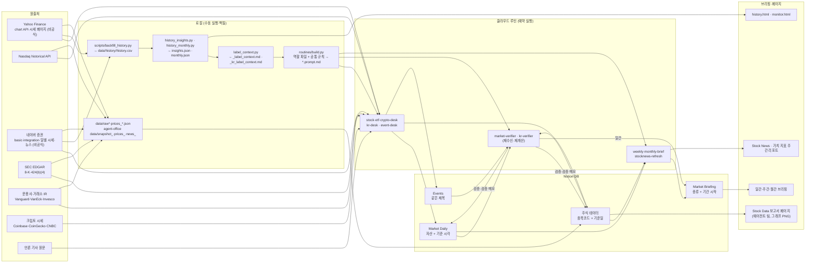

# 데이터 계보 (market-watch · agent-office)

원출처에서 받은 값이 어떤 파일과 스크립트를 거쳐 어느 Notion DB와 페이지에 도착하는지 정리한 문서다. 단계마다 값이 틀리지 않게 막는 장치도 함께 적었다.
기준 시점은 2026-09-27이다. Notion 페이지·DB의 ID는 공개용이라 적지 않는다(ID는 각 폴더의 `CLAUDE.md` 고정 대상 표에 있다).

## 단계별 표

| 단계 | 입력 | 처리 | 출력 | 품질 장치 |
|---|---|---|---|---|
| 1. 원출처 수신 (해외) | Yahoo chart API 일봉·시세 페이지, Nasdaq historical, 운용사 IR(ETF 보유·보수·순자산), SEC 424(b)(4), 언론 원문 | 담당 루틴이 `urllib`로 직접 받음. 요청 사이 간격·재시도(429 대응) | 행 속성·본문의 값과 `출처` 칸(이름 + URL + 조회 시각) | **기준 시각 규칙**: 주식·ETF = 뉴욕 16:00 종가 시각을 KST로. 크립토 = 받은 시각. 작성 시각과 섞지 않음. 비공식 경로는 출처에 `(비공식 경로)` 표기. 같은 출처라도 엔드포인트가 다르면 값이 다를 수 있어(EPS −1.05/−1.10) 엔드포인트·시각을 함께 적음. 누락 봉은 다른 출처로 채우고 본문에 밝힘 |
| 1'. 원출처 수신 (국내) | 네이버 증권 `basic`·`integration`(시세·지표·컨센서스), 일별 시세 API, 뉴스 API | kr-desk 루틴 또는 `agent-office/scripts/collect_naver.py` | 행 속성·본문 / 로컬 `snapshot_·prices_·news_<기준일>.json` | **기준일** = `basic.localTradedAt` 날짜(휴장일에는 새 행을 만들지 않음). 외국인 소진율은 일별 동향표 보유율과 대조해 실제 날짜를 따로 적음. PER·PBR은 `실적 기준`, 배당은 `배당 기준`을 따로 적음. 가격은 `basic`·`totalInfos`만. 52주 값은 표기값만. 이동평균·ATR은 일별 시세만 사용(경로를 섞지 않음). 수집기 자체 검산: 현재가 = 전일 + 전일 대비 |
| 1''. 원출처 수신 (이벤트) | SEC EDGAR 8-K `acceptanceDateTime`, 거시 일정 공식 출처 | event-desk 루틴 | Events 행 | 실적 발표 시점은 8-K 접수 시각(UTC → 뉴욕)으로 정함. `미정` 행은 자동으로 재측정하고 전후 값을 남김. 외부 요청 연락처는 개인 주소 하나로 고정 |
| 2. 원자료 보존 | 1단계 응답 | 로컬 수동 실행 때 JSON·HTML을 그대로 저장 | market-watch `data/raw*`·`data/prices_*`, agent-office `data/snapshot_*`(`_raw` 필드에 표기 문자열 원문) | 검증과 차이 추적에 씀. **한계**: 클라우드 루틴은 로컬 파일을 남기지 않는다. 예약 실행의 원자료는 `출처` 칸의 URL·조회 시각으로만 추적된다 |
| 3. 백필·파생 지표 | Yahoo·네이버 일봉 (2024-01~) | `backfill_history.py` → `history_insights.py`·`history_monthly.py` → `label_context.py` | `data/history/history.csv`·`insights.json`·`monthly.json`, 루틴용 `_label_context.md`·`_kr_label_context.md`, `history.html` | 계산식이 루틴 공통 규칙(`_common.md`)과 같다(이동평균 단순 평균, ATR 와일더 평활, 200일선이 없으면 한 칸 내린 식). 과거 성과 표는 월 1회만 갱신 |
| 4. 프롬프트 조립 | 역할 파일 `_*.md`, 공통 규칙 `_common.md`·`_kr_common.md`, 과거 참고 표 | `routines/build.py` | `*.prompt.md` (루틴 10개) | 규칙은 원본 한 곳에서만 고치고 조립한다. **재등록 뒤 루틴에 저장된 프롬프트를 `*.prompt.md`와 스크립트로 글자 단위 대조**한다(손으로 옮기다 한 줄이 바뀐 적 있음). Stock News 템플릿은 sha256으로 확인. 루틴에서 알림·보조 에이전트·예약 깨우기를 `disallowed_tools`로 막음 |
| 5. Notion 기록 (upsert) | 1단계 값 + 식으로 계산한 값 | 담당 루틴 / 에이전트 팀(`stock-collector`) | Market Daily·주식 데이터·Events·Market Briefing 행 | **멱등 upsert 키**: Market Daily = 자산 + 기준 시각, 주식 데이터 = 종목코드 + 기준일, Events = 같은 제목, Market Briefing = 종류 + 기간 시작. 같은 키가 있으면 새로 만들지 않고 갱신한다. 자산별 `최신` 체크는 하나만 둔다. `실행 방식`(수동/예약)을 기록한다. 정해진 식의 값에는 (산출) 태그를 단다. 로컬 수집은 적재 뒤 DB를 다시 읽어(`db_export_<기준일>.json`) 스냅샷과 숫자를 대조한다 |
| 6. 검증 | `검증 = 대기` 행, 원출처 | market-verifier·kr-verifier 루틴 / 에이전트 팀 `stock-verifier` | 행의 `검증`·`검증 메모`, 로컬 `verify_*.md`·`warnings.md` | **검증 담당 재수신·재계산**: 원출처를 직접 다시 받고, 이동평균·ATR·52주 위치·구간·손절을 python3로 다시 계산한다. 판정은 PASS / WARNING / ERROR / NEED MORE INFO, 모든 판정에 근거 값과 계산식을 적는다. 시점 차이로 대조할 수 없으면 추정하지 않고 NEED MORE INFO. 여러 행 읽기는 조회 한도가 없는 view 모드만 쓴다 |
| 7. 브리핑·페이지 | 검증된 행 | market-verifier(일간), weekly·monthly-brief, stocknews-refresh, 에이전트 팀 `stock-reporter` | 일간·주간·월간 브리핑, Stock News, 가치 지표 주간 리포트, Stock Data 보고서 페이지(matplotlib PNG) | 브리핑은 같은 자산·같은 시장 날짜의 행이 여럿이면 대표 행 하나로 센다. 다음 날 검증 담당이 브리핑 숫자를 다시 계산한다. 보고서 그래프 숫자는 스크립트가 DB 내보내기 파일에서 읽는다(손으로 적지 않음). 출처를 바꾸면 표뿐 아니라 페이지 전체에서 옛 출처 문구를 검색한다 |
| 8. 지표·공개본 | `history.csv`, Events 스냅샷, 루틴 실행 장부 | `event_study.py`·`forward_track.py`·`signal_eval.py`·`ops_metrics.py`, `export_public.py` | `metrics/*`, 공개 저장소 사본 | Notion은 스크립트가 직접 읽지 않고, 세션이 view 모드로 저장한 스냅샷만 읽는다. 표본 밖 판단은 한 번 기록하면 고치지 않는다. 공개본은 허용 목록 파일만 복사하고 ID·연락처·로컬 경로를 가린 뒤 금지어를 검사한다 |

## 알려진 한계

- 예약 실행에는 로컬 원자료 보존이 없다(2단계). 사후 검증은 원출처를 다시 받아서 한다. 그래서 기준일이 지난 행은 원출처 값이 바뀌어 대조할 수 없는 항목이 생긴다(NEED MORE INFO).
- 원출처 중 Yahoo chart API, 네이버 증권 API, 크립토 시세 일부는 공개 문서가 없는 내부 경로다. 경로나 응답 형식이 예고 없이 바뀔 수 있다.
- 이슈 발생과 규칙 반영의 시각을 따로 기록하지 않은 이슈가 있다(`metrics/issues_summary.md` 참고).
